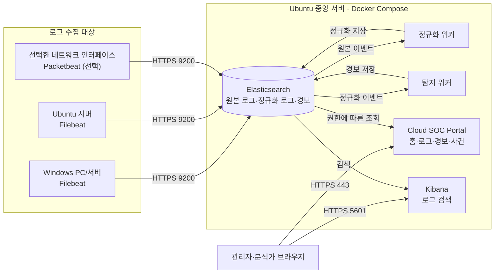
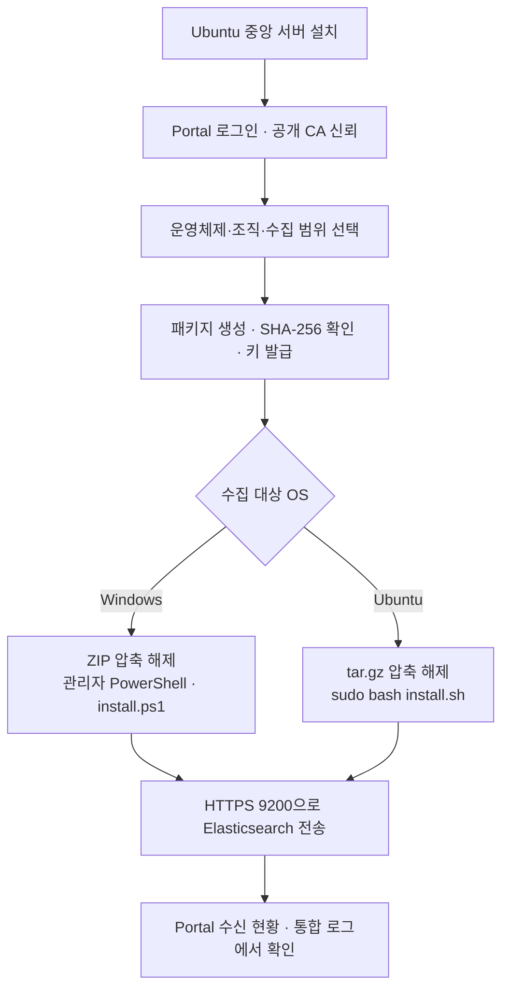

# 처음 설치 전체 안내

[빠른 시작](../README.md)

**Windows·Ubuntu 로그를 중앙에 수집하고, 탐지 경보부터 증거 확인·사건 조사까지 연결하는 Mini SIEM**입니다. 이 문서는 **처음 설치하는 사용자**를 위한 안내입니다. Ubuntu 중앙 서버를 먼저 설치한 뒤 Windows 또는 Ubuntu 수집 대상에 에이전트를 설치하세요.

> **설치 대상:** 단일 노드 실습·소규모 검증 환경. 중앙 서버는 Ubuntu Server 22.04/24.04/26.04 LTS(amd64/arm64), 수집 에이전트는 Windows 64비트 또는 지원되는 Ubuntu 환경을 기준으로 합니다. 기존 설치가 있는 시스템에는 신규 설치기를 다시 실행하지 마세요.

## 1. 전체 구성도



- **Filebeat:** Windows 이벤트 로그, Ubuntu journald·파일 로그 등 승인한 시스템 로그를 수집합니다.
- **Packetbeat(선택):** 지정한 NIC의 네트워크 흐름·DNS·TLS 등의 메타데이터를 수집합니다. PCAP이나 통신 본문을 저장하는 구성이 아닙니다.
- **중앙 서버:** Elasticsearch에 로그를 저장하고, 정규화·탐지 워커를 통해 경보를 생성합니다. Portal과 Kibana에서 조회합니다.
- **조직 구분:** `organization.id`는 분류용 필드입니다. 조직별 접근 통제는 중앙의 계정·정책과 인덱스 권한으로 별도로 설정해야 합니다.

## 2. 설치 전 준비

| 구분 | 준비 사항 |
| --- | --- |
| 중앙 서버 | 새 Ubuntu Server 22.04/24.04/26.04 LTS, systemd, amd64/arm64 |
| 권장 자원 | RAM 8GiB 이상(실제 런타임 예산 최소7GiB 및 가용 메모리 확인), 여유 디스크 10GiB 이상 + 로그 저장 공간, 소규모 실습 2 vCPU부터 |
| 기존 Docker | CLI/Engine24.0.0 이상·Compose2.24.0 이상 및 필수 기능 확인. 호환 버전은 재사용, 낮거나 기능이 없으면 업데이트 안내 후 중단 |
| 중앙 서버 접속 | `sudo` 권한, SSH 또는 직접 터미널, GitHub·Ubuntu APT·Docker·Elastic 다운로드 가능 |
| 주소 | 관리자 PC가 접속할 DNS/IPv4와 Ubuntu 서버에 **실제로 할당된** 바인딩 IPv4 |
| 관리자 네트워크 | HTTPS 443(Portal), 5601(Kibana) |
| 에이전트 네트워크 | HTTPS 9200(Elasticsearch 수신); 에이전트에서 중앙 서버까지 실제 도달해야 함 |
| Windows 수집 대상 | 64비트 Windows, 관리자 PowerShell 5.1 이상, 허용된 스크립트 실행·.NET 환경 |
| Ubuntu 수집 대상 | Ubuntu 22.04/24.04, Python 3·systemd 및 설치기에 필요한 표준 도구 |
| 네트워크 수집(선택) | 실제 NIC 이름/GUID. Windows는 승인된 Npcap 별도 설치 |

**방화벽·클라우드 보안그룹**에서 443과 5601은 관리자·분석가의 허용 IP/VPN으로, 9200은 승인된 수집 서버·VPN으로 제한하세요. SSH 22도 관리자 접속원만 허용합니다. 인터넷 전체에 공개하지 마세요. 설치기는 방화벽과 클라우드 보안그룹을 자동 변경하지 않습니다.

## 3. Ubuntu 중앙 서버 설치

이 절차는 **새 중앙 서버의 최초 설치**에만 사용합니다. 저장소 경로에 공백이나 특수문자가 없도록 설치합니다.

### 3-1. 소스 내려받기

**Ubuntu 중앙 서버 터미널**에서 실행합니다.

```bash
sudo apt-get update
sudo apt-get install -y git
git clone --branch main https://github.com/Gandalem/cloud-soc.git
cd cloud-soc

# 서버에 실제 할당된 IPv4 확인
ip -4 -brief addr
```

### 3-2. 중앙 서버 설치

아래 예시의 `10.0.0.10`을 **해당 Ubuntu 서버의 실제 IPv4**로 변경하세요. 이 주소는 관리자 PC와 수집 대상에서 접근할 수 있어야 합니다.

```bash
sudo sh deploy/server/install-ubuntu.sh --host 10.0.0.10 --bind-ip 10.0.0.10
```

DNS 이름과 수집 주소를 다르게 사용할 때는 다음 형태로 지정합니다. `soc.example.com`은 설명용 예시이며 실제 소유·설정된 DNS로 교체해야 합니다.

```bash
sudo sh deploy/server/install-ubuntu.sh \
  --host soc.example.com \
  --agent-host 10.0.0.10 \
  --bind-ip 10.0.0.10
```

- `--host`: 관리자 브라우저에서 접속할 DNS 또는 IPv4. URL의 `https://`나 포트는 입력하지 않습니다.
- `--agent-host`: 에이전트가 실제 접속할 수신 DNS 또는 IPv4. 생략 시 `--host`와 동일합니다. 외부 PC에 사설 IP를 지정해도 자동 연결되지는 않습니다.
- `--bind-ip`: 중앙 서버 NIC에 실제로 할당된 IPv4. AWS EC2는 **공인 NAT 주소가 아닌 프라이빗 IPv4**를 사용합니다.

설치 중 호스트 변경 승인과 **Portal 관리자 비밀번호 설정**을 요청합니다. 비밀번호는 터미널에서 직접 입력하며 명령 인자나 파일에 적지 않습니다. 설치기는 필요한 패키지·Docker/Compose·TLS 인증서·중앙 상태를 준비하고 공통 런타임을 기동한 뒤 로컬 HTTPS 시작 상태를 확인합니다.

설치 확인은 `y`/`yes`로 응답하며 대소문자는 구분하지 않습니다. Ubuntu의 `sudo` 비밀번호와 새 Portal 비밀번호는 별개입니다. 보안 입력에는 글자나 별표가 보이지 않습니다. 한국어로 표시되는 단계에 따라 진행하며 이미지 빌드·다운로드는 외부 도구의 원문 출력을 함께 표시합니다. Elasticsearch·Kibana·Caddy의 검증 버전 이미지가 있으면 재사용하고, 없다면 자동으로 준비합니다.

인증서와 `state/server/compose.env` 생성 후 중단됐다면 설정을 지우거나 최초 설치기를 반복하지 말고 [부분 설치 복구](../README.md#7-문제-해결기존-설치)를 따르세요. `runtime_ready: true`는 서버 실행 준비 통과이며, `existing_keys_replaced: false`는 기존 키 보존을 뜻합니다. `live_acceptance: not_verified`는 실제 에이전트 수집·탐지가 아직 확인되지 않았다는 뜻입니다.

**설치 완료 후 확인:**

```bash
sudo docker compose \
  --env-file state/server/compose.env \
  -f deploy/server/compose.yaml ps -a
```

`elasticsearch`, `portal`, `kibana`, `gateway` 및 필수 워커 상태를 확인하세요. 초기화가 정상 종료된 `bootstrap`의 `Exited (0)`은 오류가 아닙니다. 실제 에이전트의 로그 수신 여부는 **5절**에서 확인합니다.

### 3-3. 접속 주소

| 목적 | 접속 주소 | 로그인 |
| --- | --- | --- |
| Cloud SOC Portal | `https://중앙-서버-주소/` | `admin` / 설치 중 직접 설정한 비밀번호 |
| Kibana | `https://중앙-서버-주소:5601` | `cloud_soc_analyst` / 서버에서 생성한 분석가 비밀번호 |
| 에이전트 수신 | `https://에이전트-수신-주소:9200` | 전용 수집 API Key. 브라우저에서 인증 없이 접속하면 HTTP 401이 정상 |

`127.0.0.1`은 해당 PC 자신을 뜻합니다. 다른 컴퓨터에서 중앙 서버에 접속할 때는 중앙 서버가 실제 제공하는 주소를 사용하세요. 9200은 관리자용 일반 웹페이지가 아닙니다.

### 3-4. Windows 브라우저에 서버 인증서 신뢰 등록

최초 설치 시 생성되는 사설 CA는 Windows가 기본적으로 신뢰하지 않습니다. **공개 CA 인증서만** 내보내고 SHA-256을 확인한 후 등록하세요.

**Ubuntu 중앙 서버:**

```bash
# cloud-soc 저장소 루트에서 실행
sudo openssl x509 -in state/server/tls/ca.crt \
  -outform DER -out "$HOME/cloud-soc-ca.cer"
sudo chmod 0644 "$HOME/cloud-soc-ca.cer"
sha256sum "$HOME/cloud-soc-ca.cer"
```

**Windows PowerShell:** 아래 `ubuntu`(SSH 계정)와 `10.0.0.10`(SSH 주소)을 실제 값으로 바꿉니다. SSH 키 인증이 필요하면 기존에 승인받은 `scp -i` 옵션을 사용하세요.

```powershell
$ca = Join-Path $env:USERPROFILE 'Downloads\cloud-soc-ca.cer'
scp 'ubuntu@10.0.0.10:/home/ubuntu/cloud-soc-ca.cer' $ca

$expected = (Read-Host 'Ubuntu에서 확인한 DER 인증서 SHA-256').Trim()
if ((Get-FileHash -LiteralPath $ca -Algorithm SHA256).Hash -ine $expected) {
    throw 'CA 인증서 해시가 다릅니다. 등록하지 마세요.'
}
Import-Certificate -FilePath $ca -CertStoreLocation 'Cert:\CurrentUser\Root'
```

브라우저를 다시 연 다음 Portal에 접속하세요. **TLS 경고를 무시하거나 인증서 검증을 끄지 마세요.** `private/`, `secrets/`, 서버 개인키는 외부 PC에 전달하지 않습니다. 조직 관리 PC에서는 인증서 등록 승인을 먼저 받으세요.

## 4. Windows·Ubuntu 에이전트 설치

에이전트는 중앙 서버에 직접 설치하는 것이 아니라 **로그를 수집할 각 PC/서버**에 설치합니다.

### 4-1. Portal에서 설치 패키지·키 만들기

1. `https://중앙-서버-주소/`에 `admin`으로 로그인합니다.
2. **에이전트 설치 파일 → 설치 파일 추가**를 엽니다.
3. 운영체제(Windows/Ubuntu), 패키지 이름, 조직 ID, 수집 항목을 선택합니다. **시스템 로그**가 기본이며 **웹 로그·네트워크**는 필요한 경우에만 선택합니다. 웹 수집에는 지원 서버 종류·사이트·로그 경로를 입력합니다.
4. 생성된 **ZIP(Windows) 또는 tar.gz(Ubuntu)** 파일을 내려받고 Portal에 표시된 **SHA-256**을 별도로 기록합니다.
5. 수집 대상별로 **키 발급**을 진행합니다. 로그 수집 키와 네트워크 수집 키는 서로 다릅니다. 수집 키는 설치 도중 보안 프롬프트에 입력하며, 패키지·명령 인자·소스 코드에 포함하지 않습니다.

패키지에는 수신 주소·조직·**공개 CA 인증서**와 설치 스크립트가 포함됩니다. Filebeat/Packetbeat 바이너리는 설치 중 공식 배포처에서 내려받아 검증하므로 인터넷 접속이 필요합니다. **ZIP/tar.gz 안의 파일은 전부 같은 폴더에 풀어야 합니다.**

설치 토큰을 선택한 경우에는 [등록 토큰 안내](agent_enrollment.md)의 서버·대상 OS 조건을 먼저 확인하고 Portal의 토큰 화면에 표시된 명령을 사용하세요. 토큰과 API 수집 키는 서로 다른 값이므로 설치 방식에 맞는 값을 입력합니다. 토큰은15분 안에 한 번 사용하며 패키지나 명령 인자에 저장하지 않습니다.

Apache·Nginx·ModSecurity·OWASP CRS는 자동 설치하지 않습니다. 웹 서버에 별도 설치·설정한 웹/WAF의 실제 로그 경로를 패키지에 지정합니다. SOC 설치와 웹사이트/WAF 구성은 별도 단계입니다.

중앙/Ubuntu 에이전트 제거는 [README의 제거 안내](../README.md#8-제거)를 따릅니다. `--apply` 전에는 계획만 표시하며 실제 제거 확인은 `y`/`yes`입니다. 기본 제거는 데이터를 보존하고, `--purge-data --remove-images`를 추가한 경우에만 중앙 데이터·인증서·비밀번호와 공통 이미지 태그를 제거합니다.

### 4-2. Ubuntu 에이전트

압축파일을 대상 Ubuntu 서버의 홈 디렉터리로 전달했다고 가정합니다. `설치파일명-setup.tar.gz`은 실제 다운로드 파일명으로 바꿉니다.

```bash
PACKAGE="$HOME/설치파일명-setup.tar.gz"

# Portal에 표시된 SHA-256과 대조
sha256sum "$PACKAGE"

mkdir "$HOME/cloud-soc-agent-package"
tar -xzf "$PACKAGE" -C "$HOME/cloud-soc-agent-package"
cd "$HOME/cloud-soc-agent-package"
sha256sum -c SHA256SUMS

# 시스템 로그 수집
sudo bash install.sh
```

**네트워크 수집까지 선택했다면**, 실제 인터페이스 이름을 확인하고 마지막 설치 명령 대신 다음을 실행합니다.

```bash
ip -br link
sudo bash install.sh --interface ens3
```

`ens3`은 예시입니다. 설치 중 **로그 수집 키**, 네트워크 포함 시 **별도의 네트워크 키**를 입력합니다. 기존 Filebeat/Elastic Agent 설치가 있으면 무작정 중복 설치하지 마세요.

### 4-3. Windows 에이전트

ZIP을 다운로드하고 Portal의 SHA-256과 대조한 뒤, **64비트 관리자 PowerShell**에서 실행합니다. `설치파일명-setup.zip`은 실제 파일명으로 변경하세요.

```powershell
$zip = Join-Path $env:USERPROFILE 'Downloads\설치파일명-setup.zip'
(Get-FileHash -LiteralPath $zip -Algorithm SHA256).Hash

$dest = Join-Path $env:USERPROFILE 'Downloads\cloud-soc-agent-package'
Expand-Archive -LiteralPath $zip -DestinationPath $dest
Set-Location $dest

# 시스템 로그 수집
.\install.ps1
```

**네트워크 수집까지 선택했다면**, 승인된 Npcap이 설치돼 있어야 합니다. NIC GUID를 확인한 뒤 마지막 설치 명령 대신 실행합니다.

```powershell
Get-NetAdapter -IncludeHidden | Select-Object Name, Status, InterfaceGuid
.\install.ps1 -InterfaceGuid '실제-NIC-GUID'
```

설치 프롬프트에 Portal에서 발급한 **로그 수집 키**와 필요한 경우 **네트워크 수집 키**를 각각 입력합니다. PowerShell 실행 정책이나 스크립트 서명 요구 사항은 조직이 승인한 방법으로 해결하세요. 인증서 검증과 실행 정책을 우회하지 않습니다.

### 4-4. 설치 흐름 한눈에 보기



## 5. 설치 후 실제 로그 수신 확인

**에이전트 설치 화면만 완료되었다고 수신 성공으로 판단하지 않습니다.** 다음 순서로 확인하세요.

**Ubuntu 수집 대상:**

```bash
sudo systemctl status cloud-soc-filebeat cloud-soc-discovery.timer --no-pager
sudo journalctl -u cloud-soc-filebeat -n 50 --no-pager
```

**Windows 수집 대상 (관리자 PowerShell):**

```powershell
Get-Service cloud-soc-filebeat
Get-ScheduledTaskInfo -TaskName Cloud-SOC-Discovery
Get-Content "$env:ProgramFiles\Cloud-SOC-Agent\discovery-report.json" -Raw
```

**중앙 Portal과 Kibana:**

1. Portal에서 **에이전트 수신 현황**을 열고 해당 장치의 마지막 중앙 수신 시각을 확인합니다.
2. **통합 로그**에서 최근 기간·해당 `host.name`·`organization.id`로 조회합니다.
3. Kibana에서는 필요한 경우 `soc-host-raw-*`(시스템 로그), `soc-network-*`(선택 네트워크 로그) Data View를 `@timestamp` 기준으로 생성하고 수신 문서를 확인합니다.
4. 직접 생성한 정상 로그인·서비스 요청 등 **허가된 테스트 이벤트**의 시각과 수집 문서를 대조합니다.

로그가 곧바로 보이지 않을 수 있습니다. 에이전트의 새 로그 파일·채널 재탐색 주기는 약 1분이고, 실제 전송·정규화·탐지 반영에는 추가 시간이 필요합니다.

## 6. Portal 화면 사용

처음 설치한 사용자의 첫 경보는 [독립 SOC 운영 인수 절차](operational_acceptance.md)로 확인합니다. 관제 상세의 **실제 워커의 규칙·버전 확인**에서 실행 보고·버전·마지막 처리를 대조하고, 지정 경보 근거 검사와 실제 브라우저·Slack 수신을 구분하세요.

| 화면 | 주소 | 무엇을 확인하나요? |
| --- | --- | --- |
| 홈 대시보드 | `/index.html` | 최근 경보·수신 로그·진행 중 사건 요약 |
| 내 대시보드 | `/dashboard.html` | 개인별 위젯 배치와 조회 기간 |
| 통합 로그 | `/logs.html` | 실제 수집 로그의 필터 검색·보호된 상세 |
| 관제 상세 | `/operations.html` | 기간별 집계·경보 목록·근거 상세(직접 접근 가능한 관제 화면) |
| 사건 조사 | `/workbench.html` | 경보와 연결된 조사·사건 기록 |
| Kibana | `https://중앙-서버-주소:5601` | Elasticsearch 로그 검색 |

`index.html`의 기본 조회 기간은 최근 24시간, `operations.html`은 최근 1시간입니다. 과거 경보가 보이지 않으면 **조회 기간을 최근 7일**로 변경하고 새로고침하세요. 경보는 의심 활동의 탐지 결과이지 공격 성공 또는 WAF 차단 성공의 증명이 아닙니다.

## 7. 설치 문제 해결

| 증상 | 먼저 확인할 것 |
| --- | --- |
| Portal/Kibana 접속 불가 | 실제 서버 주소, 443/5601 허용 IP, 서버 바인딩 IP, CA 신뢰 및 Docker 서비스 상태 |
| HTTPS 인증서 오류 | 접속 주소가 인증서의 DNS/IP와 일치하는지, 공개 CA 해시를 확인해 신뢰 등록했는지 |
| 에이전트 수신 없음 | 에이전트에서 9200 접속 가능 여부, API Key 유효기간, CA, `Filebeat` 서비스 로그, 마지막 수신 시각 |
| 네트워크 로그 없음 | 실제 NIC 이름/GUID, 트래픽이 해당 NIC를 지나는지, Windows Npcap, Packetbeat 서비스 |
| 설치 도중 중단 | 기존 `state/server`·에이전트 큐·키를 삭제하거나 최초 설치기를 재실행하지 말고 오류 로그를 확인 |
| 경보가 화면에 안 보임 | 조회 기간·조직 권한·수신 여부 확인. 수집된 모든 로그가 탐지 경보를 생성하는 것은 아님 |

중앙 서버 상태 확인:

```bash
cd cloud-soc
sudo docker compose \
  --env-file state/server/compose.env \
  -f deploy/server/compose.yaml ps -a
sudo docker compose \
  --env-file state/server/compose.env \
  -f deploy/server/compose.yaml logs --tail 100 portal elasticsearch gateway
```

설치 중 생성된 `state/server`, 에이전트 데이터 디렉터리, 키와 큐는 보호해야 합니다. **문제 해결을 위해 `docker compose down -v`로 저장 데이터를 삭제하지 마세요.**

## 8. 이미 설치한 장치와 별도 Security Mall 실습

- **기존 중앙 서버:** 최초 설치기를 다시 실행하지 말고 [중앙 런타임 업데이트 절차](runtime_deployment.md)를 따르세요.
- **기존 Windows·Ubuntu 에이전트:** 새 설치 패키지로 덮어쓰지 말고 [Windows 갱신](windows_discovery_update.md)·[설치 복구](windows_install_recovery.md)·[등록 토큰 지원 범위](agent_enrollment.md)를 확인하세요.
- **Security Mall / ModSecurity WAF:** 별도 격리 실습 환경에서 **WAF 로그 → 정규화 → `WEB-WAF-01` 경보 → 전용 Portal 근거 확인**까지 실제 검증한 시나리오입니다. **위 일반 중앙 서버 설치만으로 Security Mall, WAF, 별도 Mall Portal이 자동 설치되거나 기존 경보 4건이 생성되는 것은 아닙니다.** 실습 구현과 범위는 [WAF 탐지](security_mall_waf_detection.md), [Mall Portal](security_mall_portal.md), [9-C 배포 계약](security_mall_9c_predeployment.md)에 분리해 두었습니다.

## 추가 문서

[중앙 서버 세부 설치](../deploy/server/README.md) · [에이전트 설치 상세](installation_reference.md) · [웹 로그 선택 수집](unified_site_agent.md) · [네트워크 수집](../deploy/agents/NETWORK.md) · [탐지 규칙·활성 범위](detection_coverage.md) · [전체 문서 색인](README.md)
