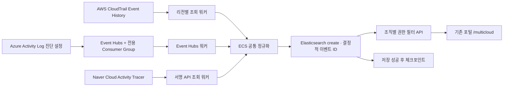

# AWS · Microsoft Azure · Naver Cloud 공통 보안 로그 수집

## 구현 범위

지정한 `integration/resolve-5009741` 브랜치의 Python 패키지, Elasticsearch 클라이언트, 개인정보 표시 함수, Flask 인증/조직 권한 및 포털 탐색 메뉴를 기반으로 확장했다. 기존 AWS 수집기와 운영 체크포인트는 변경하지 않는다. 새 수집기는 별도 `soc-multicloud-*` 인덱스와 상태 디렉터리를 사용한다.

공통으로 실제 연결하는 대상은 **계정·제어 영역 감사 로그**다. AWS는 CloudTrail Event History, Azure는 Activity Log를 내보낸 Event Hubs, Naver는 Cloud Activity Tracer의 GetActivityList API다. 이들은 보안 감사에 사용할 수 있으나 각 클라우드가 동일한 행위를 전부 기록한다는 의미는 아니다. VPC Flow, WAF, GuardDuty, Defender, Entra Sign-in, Naver Cloud Log Analytics의 전체 수집을 구현했다고 주장하지 않는다. 기존 AWS 스트리밍·호스트 수집 경로는 유지된다.

공유 ChatGPT 대화는 접근 도구에서 내용을 반환하지 않아 반영하지 못했다. 현재 사용자 메시지와 저장소를 기준으로 작성했다.

## 구성



수집기 하나가 중단되어도 다른 클라우드 수집기는 계속 실행하도록 소스별 독립 프로세스를 사용한다. AWS/Naver의 SQLite scope 지문과 프로세스 잠금이 같은 상태 파일의 재사용/동시 실행을 차단한다. Azure는 전용 Consumer Group과 Blob checkpoint 저장소로 파티션 소유권과 재시작 위치를 유지한다. Azure 컨테이너는 소스마다 독립적인 Event Hub + Consumer Group 조합을 사용해야 한다. 다른 조직 수집기와 동일 조합을 공유하지 않는다.

## 공통 스키마

|필드|의미|
|---|---|
|`@timestamp`|원본 이벤트 발생 시각 UTC|
|`event.ingested`|이벤트 정규화 시각 UTC|
|`organization.id`|운영자가 구성 파일에 지정한 조직|
|`cloud.provider`|`aws`, `azure`, `naver`|
|`cloud.account.id`|AWS account / Azure subscription / Naver member 번호|
|`cloud.region`|원본 리전. 글로벌 이벤트는 빈 값일 수 있음|
|`event.id`|조직·클라우드·계정·dataset·원본 ID의 SHA256|
|`event.dataset`|`aws.cloudtrail`, `azure.activitylogs`, `naver.cloudactivitytracer`|
|`event.action`, `event.outcome`|원본 작업명, success/failure/unknown|
|`event.category`|로그인 관련 작업은 authentication, 나머지는 configuration|
|`user.id`, `source.ip`, `resource.id`|표시 정책 적용 행위자/리소스, 유효 IP만 저장|
|`soc.collector_id`|구성 파일의 수집기 ID|

이는 ECS 필드에 맞춘 감사 로그 투영이며, OCSF 전체 준수나 완성된 위협 분류 엔진을 의미하지 않는다. 비로그인 작업의 category는 현재 configuration으로 단순 분류한다. 원본 요청 파라미터, 토큰, 응답 본문, Naver productData는 인덱싱하지 않는다. 원본 보존이 필요하면 각 클라우드의 기존 보관소에 별도 접근 통제·보존 정책을 적용한다. 해당 보관소를 새로 생성하거나 수정하는 작업은 수행하지 않았다.

## 전달 보장과 한계

- 저장은 `create`와 결정적 ID를 사용한다. 같은 이벤트 재조회는 409를 성공한 중복으로 취급한다. 이벤트 발생일 인덱스를 사용하므로 재시도 시 날짜 인덱스가 달라지지 않는다.
- AWS/Naver는 15분 구간·10분 겹침·현재 시각보다 5분 뒤처진 상한을 사용한다. 모든 페이지의 저장이 성공해야 watermark를 전진한다. 실패 시 이전 위치부터 재시도한다.
- Azure는 Event Hubs 메시지 내 모든 records 저장 이후에만 해당 파티션 checkpoint를 저장한다. 실패하면 수신을 중단하여 재시작 시 재전송한다. 실패 메시지를 건너뛰는 자동 DLQ는 구현하지 않았다. 계정 불일치/파싱 오류도 운영자가 원인을 해결할 때까지 위치를 유지한다.
- 조회 API의 이벤트 정렬이 고정 스냅샷이라는 보장은 없다. 늦게 반영된 이벤트가 겹침 범위를 넘으면 누락될 수 있다. 장기 완전성 요구 시 AWS S3/SQS 아카이브 경로 및 Naver 장기 원본 보관·재수집 경로가 별도로 필요하다. AWS Event History는 90일 관리 이벤트로 제한된다. Naver는 이 구현에서 30일 초과 시작 범위를 거부한다.
- Azure 시작 시각보다 오래된 checkpoint가 존재하면 checkpoint가 우선한다. Event Hubs 보존 기간을 넘은 중단 구간은 복구가 보장되지 않는다. 기존 checkpoint 삭제/되감기는 자동으로 하지 않는다.
- API/정규화/저장 실패는 SDK 예외의 유형만 출력한다. AWS/Naver 상태 파일에는 watermark·마지막 성공 시각·오류 유형이 남는다. 모든 오류를 재시도하므로 영구 설정 오류는 운영자 조치가 필요하다.
- 포털의 마지막 이벤트 시각은 이벤트 데이터 기준이다. 수집기 실행 상태나 무로그 상태의 정상 여부를 증명하지 않는다. 실패 건수는 감사 작업의 실패 건수이며 수집 장애 건수가 아니다.
- 일별 인덱스 보존/ILM/백업 정책은 운영 환경에 맞게 별도 설정해야 한다. 자동 데이터 삭제는 포함하지 않았다.

## 클라우드별 연결 준비

### AWS

계정과 리전마다 별도 source ID를 작성한다. `account`는 STS로 확인한 호출 계정과 같아야 한다. 기본 자격 증명 체인(인스턴스 역할 권장) 또는 `profile`을 사용한다. 관리 이벤트 조회용 IAM 정책은 아래 소스 기반 생성 명령으로 별도로 생성한다. 이번 요청의 검수 제외 범위에 따라 생성 도구를 실행하지 않았다. STS GetCallerIdentity 호출로 계정 일치를 확인한다. 새 Trail이나 IAM Role을 생성하지 않는다. Event History는 관리 이벤트만 수집하며 S3 데이터 접근/Flow/WAF 수집과 다르다.

정책 생성 명령 제안(실행하지 않음):

```bash
uvx iam-policy-autopilot@latest generate-policies \
  /home/yoonji/Documents/Codex/2026-11-01/https-chatgpt-com-share-6ae6c747-7198/outputs/cloud-soc/src/cloud_soc/multicloud/collectors.py \
  --service-hints cloudtrail sts --pretty
```

### Azure

1. 대상 구독의 Activity Log 진단 설정에서 필요한 로그 범주를 Event Hubs로 내보낸다.
2. 대상 Hub에 전용 Consumer Group을 준비한다. 수신 연결 문자열은 Listen 권한을 사용한다.
3. 별도 Blob 컨테이너를 checkpoint용으로 준비하고 읽기/쓰기 가능한 Storage 연결 문자열을 설정한다. 현재 구현은 연결 문자열 인증이며 Managed Identity는 미구현이다.
4. `account`에는 subscription GUID를 넣는다. `resourceId` 또는 `subscriptionId`에서 같은 GUID가 확인되는 레코드만 수용한다. Entra tenant 로그와 임의 메시지를 섞지 않는다.
5. 환경변수 `SOC_AZURE_EVENTHUB_CONNECTION`, `SOC_AZURE_STORAGE_CONNECTION` 또는 각각의 `_FILE` 비공개 파일을 제공한다. 파일은 Linux에서 chmod 600이고 실행 사용자 소유여야 한다.

### Naver Cloud

Cloud Activity Tracer 조회 권한이 있는 전용 Sub Account API 키를 사용한다. 설정의 `account`는 NRN 다섯 번째 구성 요소의 member 번호다. 수신 레코드의 NRN과 비교한다. 상용 Public 엔드포인트를 사용하며 공공/금융 별도 엔드포인트 지원은 포함하지 않는다. `SOC_NAVER_ACCESS_KEY`, `SOC_NAVER_SECRET_KEY` 또는 각각의 `_FILE`로 비밀 값을 제공한다. POST `/api/v1/activities`에 HMAC-SHA256 서명과 millisecond 시각을 붙이며 page/hasMore를 끝까지 처리한다.

## 설치 및 실행 절차

아래는 사용자가 실행할 운영 명령이다. 이번 작업에서는 실행하지 않았다. 기존 서버의 venv/서비스를 덮어쓰지 말고 별도 환경으로 설치한다.

```bash
python3.12 -m venv .venv-multicloud
.venv-multicloud/bin/pip install -r requirements-multicloud.txt
.venv-multicloud/bin/pip install --no-deps -e .
cp config/multicloud.example.json config/multicloud.json
```

구성 파일의 계정·조직·리전·시작 시각·Hub/Consumer Group을 실제 값으로 수정한다. 예시 날짜는 자동 현재 시각이 아니며 필요한 수집 시작 시각을 명시해야 한다. 비밀 값은 구성 JSON에 넣지 않는다.

기존 클라이언트가 읽는 `ELASTICSEARCH_URL`, `ELASTICSEARCH_CA_FILE`, `ELASTICSEARCH_API_KEY_FILE`을 지정한다. 원격 ES는 HTTPS와 신뢰할 CA를 사용한다. 최초 템플릿 생성은 별도의 setup 권한으로 한 번 실행하고, 수집 때는 writer 키로 바꾼다.

```bash
.venv-multicloud/bin/python -m cloud_soc.multicloud install
.venv-multicloud/bin/python -m cloud_soc.multicloud collect --config config/multicloud.json --source aws-audit-oregon
.venv-multicloud/bin/python -m cloud_soc.multicloud collect --config config/multicloud.json --source azure-audit
.venv-multicloud/bin/python -m cloud_soc.multicloud collect --config config/multicloud.json --source naver-audit
```

세 collect 명령은 각각 별도 터미널/서비스에서 실행한다. `deploy/multicloud/cloud-soc-collector@.service`는 설치 경로 `/opt/cloud-soc/.venv`를 전제로 하므로 별도 환경을 사용할 경우 ExecStart를 그 경로로 맞춘다. `/var/lib/cloud-soc/multicloud`는 cloud-soc 사용자 전용 쓰기 디렉터리, `/etc/cloud-soc/multicloud.env`와 자격 증명 파일은 해당 사용자에게만 읽기 허용한다. 서비스 설치/기동은 자동으로 수행하지 않았다.

Docker를 사용할 경우 `deploy/multicloud/Dockerfile`과 `compose.yaml`을 제공한다. 필요한 환경변수와 비밀 파일을 준비하고 원하는 profile만 기동한다. 선택한 profile에 해당하는 연결 환경변수를 제공한다. 비선택 서비스의 연결 값은 비워둘 수 있으며, 선택 서비스에 필요한 값이 없으면 시작 시 오류로 중단한다. 인스턴스 역할 사용 시 EC2 IMDS hop limit/컨테이너 접근 정책에 따라 자격 증명 접근을 구성해야 한다. 이미지에는 profile이나 키가 포함되지 않는다.

## 포털 연결

수정된 기존 포털을 운영자가 반영한 후 **보안 관제 → 멀티 클라우드** 또는 `/multicloud`에 접근한다. 별도의 데모 서버를 만들지 않는다. 기존 포털 세션/Basic 인증을 사용하고 읽기 허용된 조직만 `organization.id` 필터로 조회한다. 조직 매핑이 없는 비관리자는 빈 결과를 받는다. 관리자 외에는 전체 조직 조회를 허용하지 않는다.

기존 `PORTAL_READ_API_KEY` 또는 monitor 계정에 새 `soc-multicloud-*` 읽기 범위가 필요하다. `deploy/multicloud/elasticsearch-roles.json`은 **역할별 권한 예시 묶음**으로, 이 JSON 전체를 단일 ES 역할 API 요청으로 보내는 형식은 아니다. 기존 reader 권한을 보존하면서 해당 인덱스 read/view_index_metadata 범위를 추가한다. writer/setup/reader 키를 분리한다. 이 작업에서 키 발급이나 권한 변경을 실행하지 않았다.

대시보드는 실데이터만 조회한다. 기간/클라우드/결과 필터, 클라우드별 건수·실패 건수·마지막 이벤트, 시간별 활동, 주요 작업, 최근 정규화 로그 100건을 제공한다. 30초 간격으로 보이는 탭만 갱신하고, 조회 실패 시 이전 데이터가 최신이 아님을 표시한다. 무한 스크롤·CSV 내보내기·원본 열람·신규 경보 규칙은 이번 구현 범위에 포함하지 않는다.

## 근거 문서

- [AWS LookupEvents](https://docs.aws.amazon.com/cli/latest/reference/cloudtrail/lookup-events.html)
- [Azure Event Hubs Python SDK](https://github.com/Azure/azure-sdk-for-python/blob/main/sdk/eventhub/azure-eventhub/README.md)
- [Azure Blob checkpoint store](https://learn.microsoft.com/en-us/python/api/overview/azure/eventhub-checkpointstoreblob-readme?view=azure-python)
- [Naver GetActivityList](https://api.ncloud-docs.com/docs/en/management-cloudactivitytracer-getactivitylist)

2026-11-01: 사용자 요청에 따라 코드·설정·문서를 작성했으며 테스트·검수·구문검사·린트·빌드·실서비스 연결·운영 배포는 수행하지 않았다. SDK 의존성은 호환 major 범위로 지정했으며 배포 환경의 정확한 버전 잠금은 남아 있다. 저장소 원격 commit/push는 수행하지 않았다.

JEONGRIM-SEO 통합 후의 권한/배포 계약과 적용 경계는 [통합 안내](multicloud_integration.md)를 우선 참고한다.
