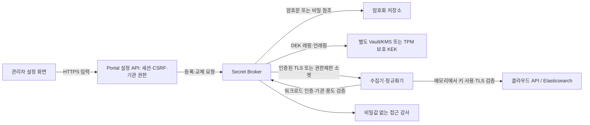

# API 키 암호화 필수 아키텍처

2026-11-02 / 설계안. 코드 경로 검토이며 운영 비밀값·파일 내용은 조회하지 않았다. 현재 이미 강제된 기능이 아니다.

## 현재 확인

|대상|확인한 코드|판정|
|---|---|---|
|멀티클라우드 인증|src/cloud_soc/multicloud/collectors.py secret()|환경변수 또는 파일 문자열. 파일권한 검사, 암호화 강제 없음. AWS는 boto3 자격증명 체인도 사용.|
|정규화 API 키 발급|src/cloud_soc/multicloud/processing_setup.py|issued.encoded를0600 파일로 저장. encoded는 암호화가 아니다.|
|Portal 조회 키|src/cloud_soc/portal/app.py PORTAL_READ_API_KEY|파일에서 읽어 ES 클라이언트에 전달. 공통 암호문 계약 없음.|
|장치 등록·재시도|portal/enrollment.py, device_management.py|일부 짧은 등록 전달 데이터에 Fernet 적용. 모든 publisher 키 저장을 암호화한다는 뜻은 아니다.|
|Slack 웹훅|notifications/store.py|Fernet 암호화 있음. 로컬 slack.key와 백업의 분리보호는 별도 검토 대상.|

별도의 범용 API키 설정 폼이 이미 운영된다고 단정하지 않는다. 키 문자열을 주입하는 기존 경로가 확인됐으며, 실제 운영 파일의 암호화 여부는 이번 코드 검토만으로 확정하지 않는다. 로그인 비밀번호는 기존 단방향 해시를 유지한다.

## 목표 구조

사용자는 전송 중 TLS 보호를 받으며 입력한 키는 API 요청 후 브라우저 상태에서 제거한다. 저장 이후 원문 재조회·표시 API는 제공하지 않는다. localStorage/sessionStorage/URL/분석 이벤트/로그/오류 본문에 키를 넣지 않는다. 브라우저 자체 암호화로 서버의 키보호를 대체하지 않는다.

## 반드시 적용할 정책

1. 저장은 Secret Broker만 담당한다. 원문 키의 DB·SQLite·설정파일·env_file·Docker 환경변수 영구 저장과 Base64 대체를 금지한다. `secret_ref`만 각 서비스 설정에 저장한다.
2. 자체 저장소는 비밀 버전별 무작위 DEK와 AES-256-GCM을 사용한다. nonce는 같은 DEK에서 절대 재사용하지 않는다. AAD에 기관ID·secretID·용도·버전·스키마를 결합하고 다른 기관/용도의 암호문 교체를 거부한다. 검증된 라이브러리·난수원을 사용한다. 자체 암호 알고리즘을 만들지 않는다.
3. DEK는 KEK로 래핑하며 KEK는 암호문 저장소·컨테이너 이미지·환경변수·일반 백업에 넣지 않는다. 운영은 별도 신뢰영역의 Vault/KMS, 또는 VM의 TPM 연동 키보호를 사용한다. Vault/KMS가 암호화와 버전관리를 제공하면 중복 자체 암호화를 억지로 추가하지 않는다.
4. 로컬 평문 마스터키 파일을 암호문 옆에 두는 방식은 운영 수용 기준을 만족하지 않는다. TPM/KMS가 없으면 이를 운영 완료로 승인하지 않고 준비 상태로 둔다. TPM 방식은 VM 복구·TPM 소실을 대비한 별도 통제 복구절차도 검증한다.
5. Portal은 관리 권한만, 워커는 할당된 기관·용도의 사용 권한만 가진다. 일반 조회 API는 원문 키를 받지 못한다. Broker 인증은 역할·짧은 수명 워크로드 신원으로 부트스트랩하고 새 평문 API키를 env에 추가하지 않는다.
6. 가능하면 AWS 역할/STS 등 단기 자격증명을 사용한다. 외부 API 호출에 원문이 필요한 순간에는 워커 메모리에 존재할 수밖에 없다. SDK가 필요로 하는 동안만 보유하고 코어덤프/디버그출력/영구임시파일을 차단한다. Python에서 모든 메모리 사본의 완전 삭제를 보장한다고 표현하지 않는다.
7. 암호화 백엔드 장애·태그불일치·권한거부·미지원 버전이면 해당 비밀 사용을 중단한다. 평문 파일/환경변수로 자동 후퇴하지 않는다. UI에는 사용할 수 없는 상태와 재시도 안내만 표시한다. 기존 정상 워커 전체가 함께 정지하지 않도록 비밀별 격리한다.
8. TLS 검증은 CA·서버명 검증을 포함한다. 사설 CA 신뢰를 구성하고 verify=false/-k를 운영 기본으로 사용하지 않는다. 세션·CSRF·역할검사는 TLS와 별도로 유지한다.
9. 비밀 접근/교체/폐기 감사에는 수행자·기관·용도·버전·시간·결과만 기록한다. 원문, 인증헤더, 암호화 데이터키, 요청본문을 기록하지 않는다. UI는 등록여부·만료·마지막검증 등 메타데이터만 반환한다.
10. 외부 API키 교체(재발급/폐기)와 KEK 교체(재래핑)는 별도 수명주기로 관리한다. 새 버전 연결시험·워커 전환 확인 후 이전 API키를 폐기한다. 백업에는 암호문/필요한 래핑DEK·메타데이터를 저장하고 KEK 복구권한은 분리한다.

예시 암호문 계약(제안): schema_version, secret_id, tenant_id, provider, purpose, version, ciphertext, nonce, wrapped_dek, kek_ref, created_at, expires_at. 원문·평문DEK·KEK는 포함하지 않는다. 외부 저장소 사용 시 secret_ref와 버전만 앱 DB에 저장한다.

제안 관리 API는 등록·교체·상태·접속시험·폐기만 제공한다. 등록 성공 응답에도 원문을 반환하지 않는다. 장치의 최초 설치 키 전달은 별도 단회·짧은 수명 등록 프로토콜을 유지하며 재조회용 키보관함으로 바꾸지 않는다.

## 기존 시스템 전환

1. 비밀의 종류·권한·사용서비스·원문 저장 위치만 목록화한다. 원문을 중앙 로그로 모으지 않는다.
2. Secret Broker와 키보호 계층을 독립 구성하고 장애·백업 복구를 검증한다. 클라우드자원/비용/권한 변경은 별도 승인 범위다.
3. 새 등록부터 암호화 저장을 강제한다. 기존 평문 사용은 명시적인 legacy 상태로 드러내며 필수 암호화 적용 완료로 표시하지 않는다.
4. 제한된 일회성 이관 도구로 기존 값을 암호화 저장하고 서비스별 secret_ref 전환·실접속을 확인한다. 키·기관·역할·탐지 체크포인트를 변경하지 않는다. 이관 중 자동 재발급·자동폐기는 하지 않는다.
5. 워커의 평문 파일/환경 fallback을 제거해 암호화 전용 모드를 강제한다. 원문이 들어간 env·Compose·설치파일·백업·Docker 컨테이너 메타데이터가 남는지도 확인한다. 롤백 역시 암호화 버전 간 전환으로 준비한다.
6. 기존 노출 가능 키는 검증 후 순차 교체·폐기한다. 파일삭제만으로 과거 디스크/백업의 완전 삭제를 보장하지 않는다.

수용 기준: 평문 저장 거부, 암호문 변조/기관교환 거부, 잘못된 워크로드 복호화 거부, KMS중단 시 평문fallback0, UI/로그/백업 비밀값 미노출, 단기키 만료·외부키 교체·KEK재래핑·복원 검증 통과. 설정 화면은 '암호화 필수'를 사용자가 끄는 옵션으로 제공하지 않는다.

## 근거

- OWASP Secrets Management Cheat Sheet: https://cheatsheetseries.owasp.org/cheatsheets/Secrets_Management_Cheat_Sheet.html
- AWS KMS 암호화·키관리 개념: https://docs.aws.amazon.com/kms/latest/developerguide/concepts.html

한계: 저장 암호화는 탈취된 백업·디스크의 기밀성 보호에 유효하지만, 복호화 권한이 있는 실행 워커나 Broker 자체가 장악된 경우의 키 사용을 완전히 막지는 못한다. 권한분리·최소권한·격리·단기키·접근감사를 함께 적용한다.
